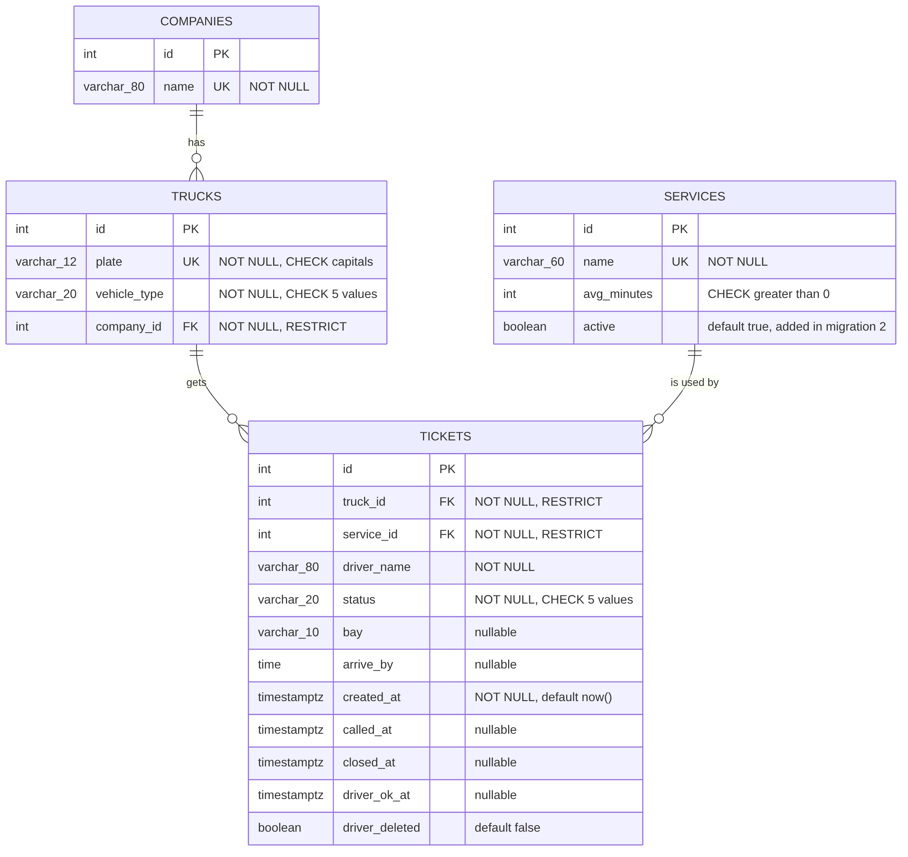

# DockQ schema

I started from ClinicQ's three tables (`users`, `services`, `tickets`) and changed them for a truck loading
bay. The person waiting is a driver with a truck, so a `users` table did not fit. Instead I split the data
into `companies`, `trucks`, `services` and `tickets`.

## 2a. Nouns in the requirements that store data

| Req ID | Requirement | Nouns | Table or column? |
| --- | --- | --- | --- |
| FR-01 | A **driver** can join the **queue** for loading or unloading, with **name**, **plate** and **company**. | driver, queue, service, name, plate, company | tickets.driver_name, *(queue is not a table)*, services, trucks.plate, companies |
| FR-02 | A driver can see their **ticket number**, **status** and how many trucks are **ahead**. | ticket number, status, ahead | tickets.id, tickets.status, *(computed)* |
| FR-03 | A driver can see the **bay** and **arrive-by time** when called. | bay, arrive-by time | tickets.bay, tickets.arrive_by |
| FR-04 | A driver can **leave** the queue. | status | tickets.status = 'left' |
| FR-06 | Staff can call trucks and give each a **bay** and **arrive-by time**. | bay, arrive-by time, time called | tickets.bay, tickets.arrive_by, tickets.called_at |
| FR-07 | Staff can mark a truck **served** or **no-show**. | status, time finished | tickets.status, tickets.closed_at |
| FR-09 | A driver can confirm (**OK**) a finished ticket and see it under My tickets. | time confirmed, hidden | tickets.driver_ok_at, tickets.driver_deleted |
| FR-10 | Staff can view finished tickets and **delete** one. | ticket | tickets (row delete) |
| FR-11 | Staff can add, rename and switch off a **service**. | name, active | services.name, services.active |
| FR-14 | A driver can choose a **vehicle type** when joining. | vehicle type | trucks.vehicle_type |

- **The queue is not a table.** It is all tickets with status `waiting` for one service, ordered by when they joined.
- **Store facts, not results.** I store when a ticket was created and compute how many trucks are ahead, and
  how many are waiting per service (FR-08). A stored position would need rewriting whenever a truck joins or leaves.

## 2b. Tables and columns

| Table | Columns |
| --- | --- |
| `companies` | id, name |
| `trucks` | id, plate, vehicle_type, company_id |
| `services` | id, name, avg_minutes, active |
| `tickets` | id, truck_id, service_id, driver_name, status, bay, arrive_by, created_at, called_at, closed_at, driver_ok_at, driver_deleted |

- A plate and a vehicle type are facts about the **truck**, so they are in `trucks`. A truck's type does not change.
- A company name is a fact about the **company**, and one company has many trucks, so it has its own table
  instead of being copied onto every truck.
- The driver's name is a fact about **this visit**, because a different driver may bring the same truck on
  another day, so it is in `tickets`, not `trucks`.
- The bay and arrive-by time are set by staff for **this visit**, so they are in `tickets`.
- Average minutes is a fact about the **service**, so it is in `services`, not copied onto tickets.
- I did not add a `bays` table, a staff table or a cargo column. No requirement stores bay data beyond its
  label, staff accounts come with login in Week 11, and the driver said cargo does not matter to him.

## 2c. Types and constraints

| Table | Column | PostgreSQL type | Constraint | Why |
| --- | --- | --- | --- | --- |
| companies | id | integer, generated | PRIMARY KEY | Generated by the database, never reused |
| companies | name | varchar(80) | NOT NULL UNIQUE | One row per company, so a name is not stored twice |
| trucks | id | integer, generated | PRIMARY KEY | |
| trucks | plate | varchar(12) | NOT NULL UNIQUE, CHECK (plate ~ '^[A-Z0-9 -]{4,12}$') | One row per truck; capitals, numbers, spaces and hyphens only |
| trucks | vehicle_type | varchar(20) | NOT NULL DEFAULT 'other', CHECK (vehicle_type IN ('4-wheeler', '6-wheeler', '8-wheeler', '10-wheeler', 'other')) | The dispatcher asked for it (FR-14); only known types are allowed |
| trucks | company_id | integer | NOT NULL, FOREIGN KEY companies(id) | No truck without a company |
| services | id | integer, generated | PRIMARY KEY | |
| services | name | varchar(60) | NOT NULL UNIQUE | No two services with the same name |
| services | avg_minutes | integer | NOT NULL DEFAULT 30, CHECK (avg_minutes > 0) | Rejects impossible loading times |
| services | active | boolean | NOT NULL DEFAULT true | Lets staff switch off a service without deleting it (FR-11); added by the second migration |
| tickets | id | integer, generated | PRIMARY KEY | The ticket number; the database guarantees no two are the same (NFR-02) |
| tickets | truck_id | integer | NOT NULL, FOREIGN KEY trucks(id) | No ticket for a missing truck |
| tickets | service_id | integer | NOT NULL, FOREIGN KEY services(id) | No ticket for a missing service |
| tickets | driver_name | varchar(80) | NOT NULL | Staff need a name to call |
| tickets | status | varchar(20) | NOT NULL DEFAULT 'waiting', CHECK (status IN ('waiting', 'called', 'served', 'no-show', 'left')) | Only these five states exist |
| tickets | bay | varchar(10) | nullable | Empty until staff call the truck; bays are labels such as "2" or "Mill", so text, not a number |
| tickets | arrive_by | time | nullable | A clock time on the same day (FR-03), so it needs no date |
| tickets | created_at | timestamptz | NOT NULL DEFAULT now() | Set by the database when a truck joins; time zone safe |
| tickets | called_at | timestamptz | nullable | Empty until staff call the truck |
| tickets | closed_at | timestamptz | nullable | Empty until the ticket is served, no-show or left |
| tickets | driver_ok_at | timestamptz | nullable | Empty until the driver confirms with OK (FR-09) |
| tickets | driver_deleted | boolean | NOT NULL DEFAULT false | Hides a ticket from the driver's history while staff keep the row for reports |

Extra rule (NFR-03): a unique **partial index** on `tickets(truck_id)` where `status IN ('waiting', 'called')`, so a
truck can have only one open ticket at a time.

This schema uses PRIMARY KEY, FOREIGN KEY, NOT NULL, UNIQUE, CHECK and `timestamptz`. No dates, times or numbers
are stored as text.

## 2d. ERD

- One company has many trucks. Each truck belongs to exactly one company.
- One truck has many tickets over time. Each ticket is for exactly one truck.
- One service has many tickets. Each ticket is for exactly one service.
- All foreign keys are on the "many" side: `company_id` in `trucks`, and `truck_id` and `service_id` in `tickets`.

| Foreign key | On delete | Reason |
| --- | --- | --- |
| trucks.company_id → companies.id | RESTRICT | A company with trucks must not be deleted, or its trucks and old tickets would lose their owner. |
| tickets.truck_id → trucks.id | RESTRICT | Old tickets are needed for reports (FR-12), so a truck with tickets cannot be deleted. |
| tickets.service_id → services.id | RESTRICT | Deleting a service must not erase its tickets. Staff switch it off with `active` instead. |

## 2e. Normalization

1. **One value per cell (1NF):** no column holds a list. The service is one id, the vehicle type is one word,
   and the status is one word.
2. **Depends on the whole key (2NF):** there is no join table, and every column depends on its table's single `id`.
3. **No hidden copies (3NF):** a company's name is stored once in `companies`, a truck's plate and vehicle type
   once in `trucks`, and a service's name and average minutes once in `services`. Tickets point to them with ids,
   so a change is made in one row.