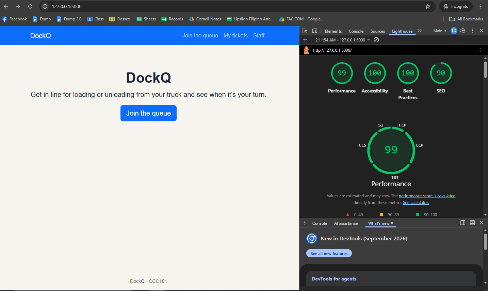
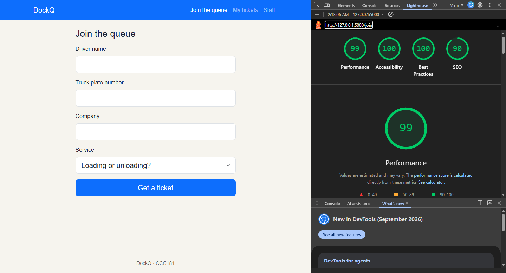
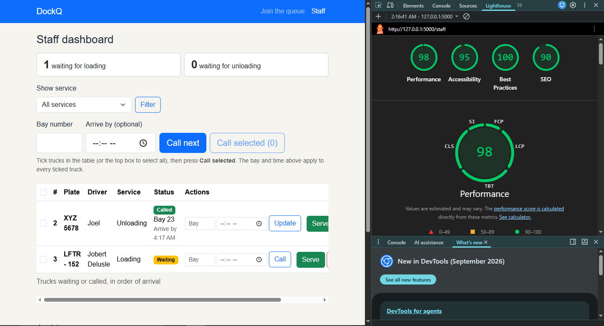

# Accessibility check

## 9a. Lighthouse (Mobile, Accessibility)

| Screen | Score before | Score after |
|---|---|---|
| Join | [ 100 ] | [ 100 ] |
| My place | [ 100 ] | [ 100 ] |
| Staff | [ 95 ] | [ 95 ] |

### Join (final score)

### My place (final score)

### Staff (final score)

**Main issue fixed:** Lighthouse did not detect any issues.

## 9b. Keyboard only

I tested using only Tab, Shift+Tab, Enter, Space and the arrow keys.

### Join the queue from the home page
- **Skip link:** yes a "Skip to main content" link appeared on the first Tab.
- **Tab order:** skip link, DockQ, Join the queue, My tickets, Staff, then the page content.
- **Form:** fields in order: driver name, truck plate number, company, service, "Get a ticket".
  The service dropdown works with the arrow keys and Enter on the button submits.
- **Focus visibility:** [a clear outline showed on every control: yes]
- **Ticket page:** after joining, I could reach "Leave the queue" and the My tickets button to see archived tickets

### Staff dashboard
- **Filter:** I reached the service dropdown, changed it with the arrow keys and applied it with Enter on "Filter".
- **Call:** "Call next" works with Enter. I can also tick a truck with Space, or the top box to select
  all, then use "Call selected". Each row has Bay and time boxes with "Call" or "Update".
- **Serve:** "Serve" and "No-show" are reachable and work with Enter. Their accessible names include
  the ticket number, for example "Mark ticket 7 as served".
- **My tickets panel:** it opens with Enter, closes with Esc, and focus stays inside while open.

### What failed and how I fixed it
1. [Anything that failed, and the fix.]
2. **Focus after an action.** After "Call next" or "Serve" the page reloads and focus goes back to the
   top. **Decision:** I left this alone because the skip link lets keyboard users jump to the content.

## 9c. Manual checklist

| Check | Join | My place | Staff |
| --- | --- | --- | --- |
| Every input has a visible label | ✅ Driver name, plate, company and service each have a `<label>` | n/a (no inputs) | ✅ Service filter, Bay and Arrive by have labels; row inputs have `aria-label` |
| Error messages say what to do, in text | ✅ e.g. "Use capital letters, numbers, spaces or hyphens only (4 to 12 characters)." | n/a (no form) | n/a (no form errors) |
| Status is shown in words, not only color | n/a | ✅ The badge says "Waiting", "Called", "Served" or "No-show" | ✅ Badges use words, plus bay and arrive-by time |
| Readable at 375 px with no sideways page scroll | [ ] | [ ] | [ ] Tables scroll inside `table-responsive`, not the page |
| Buttons about 44 × 44 px on a phone | [ ] "Get a ticket" is full width and large | [ ] "Leave the queue" and "OK" are `btn-lg` | [ ] Row buttons and the small Bay/time inputs (`-sm`): [fix if flagged] |
| One `<h1>` and headings in order | [ ] | [ ] | [ ] |
| `<html lang="en">` is set | ✅ Set once in `base.html` | ✅ | ✅ |

Mark each `[ ]` ✅ or ❌ with the fix, after checking it in Chrome at 375 px.
