# Week 3 Report: Qonnect Interface

## Title details

| | |
| --- | --- |
| **App name** | DockQ|
| **Setting** | Loading Bays and Dispatch Offices |
| **Full name** | Sam B. Tomenio |
| **Student ID** | 20241845 |
| **Section** | CS3A |
| **Date** | October 25, 2026 |
| **Pull request** | https://github.com/SamTomenio/CCC181---Que/pull/1 |

## Personas

Full personas: [docs/week3/personas.md](personas.md)

### Ramon, the Driver

41, truck driver who delivers to and loads at a feed-mill loading bay in Iligan City, 3-5 trips a week.

> ""Lisod na gali mag hulat liny ana tawo truck pa, kapoy baya mag hulat sa linya "

**Top tasks:**
1. Join the loading or unloading queue (FR-01)
2. Check ticket number and how many trucks are ahead (FR-02)
3. See when and where I am called (bay, arrive-by time) (FR-03)
3. Leave the queue if my plans change (FR-04)

### Liza, the Dispatcher  

28, dispatcher at the loading bay who decides which truck goes in next and tracks who is present.

> "It's hard to cope with a lot of people moving around, and hard to track them down when they aren't there."

**Top tasks:**
1. See the waiting list, filtered by service (FR-05)
2. Call the earliest waiting ticket for the selected service (FR-06)
3. Mark a ticket as served or no-show (FR-07)
3. Mark a ticket as served or no-show (FR-08)
    
## Screens

### Screen 1: Join the queue

Ramon uses this screen to line up and get a ticket, covering **FR-01** (A driver can join the queue for loading or unloading)

| Phone | Laptop |
| --- | --- |
| 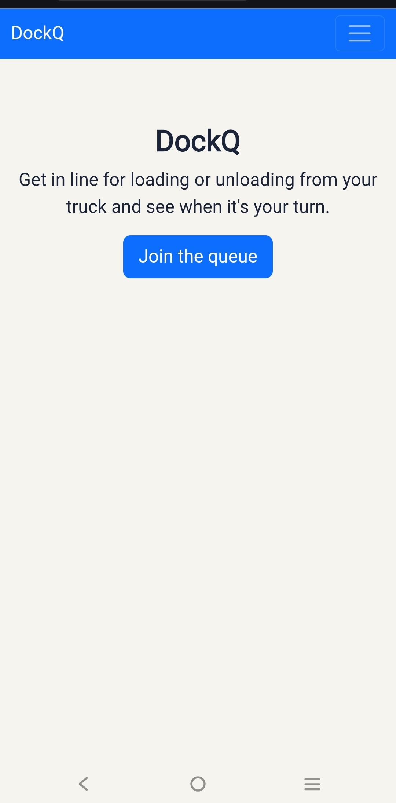 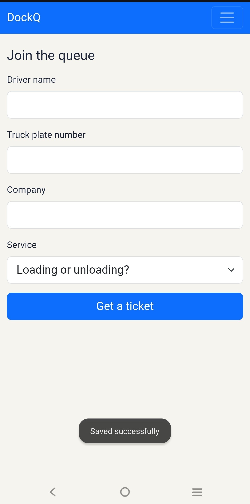 | 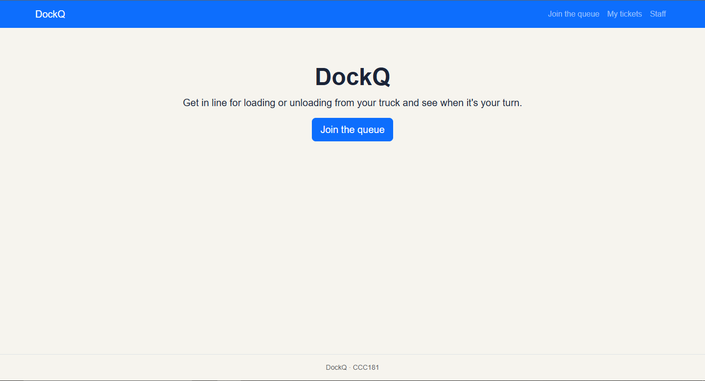 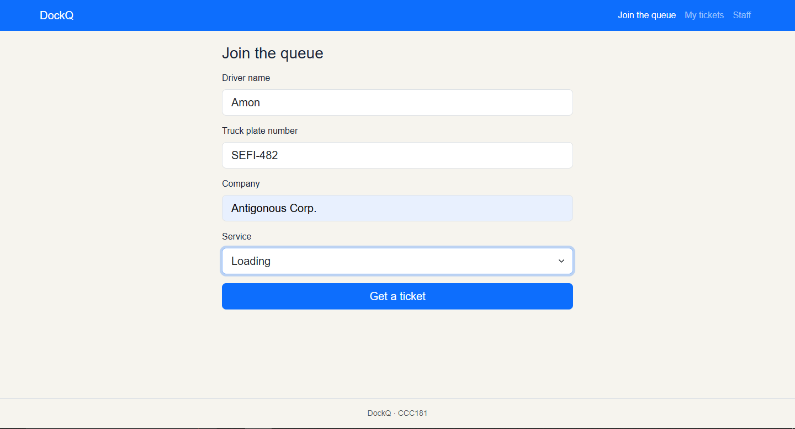|

### Screen 2: My ticket

Ramon uses this screen to see his ticket number, status and how many people are ahead of him, covering **FR-02** (A driver can see their ticket number and how many trucks are ahead), **FR-03** (A driver can see when and where they are called (bay, arrive-by time)) and **FR-04** (A driver can leave the queue.)

| Phone | Laptop |
| --- | --- |
| 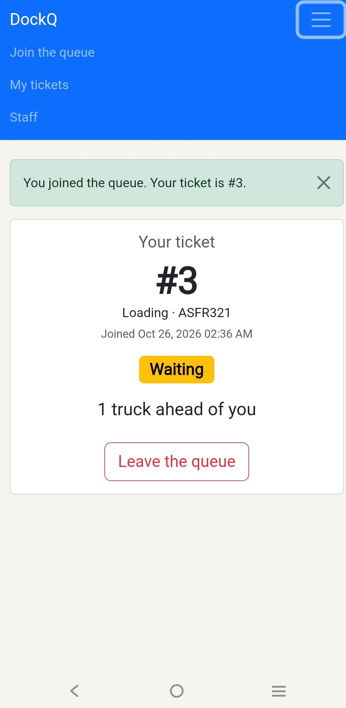 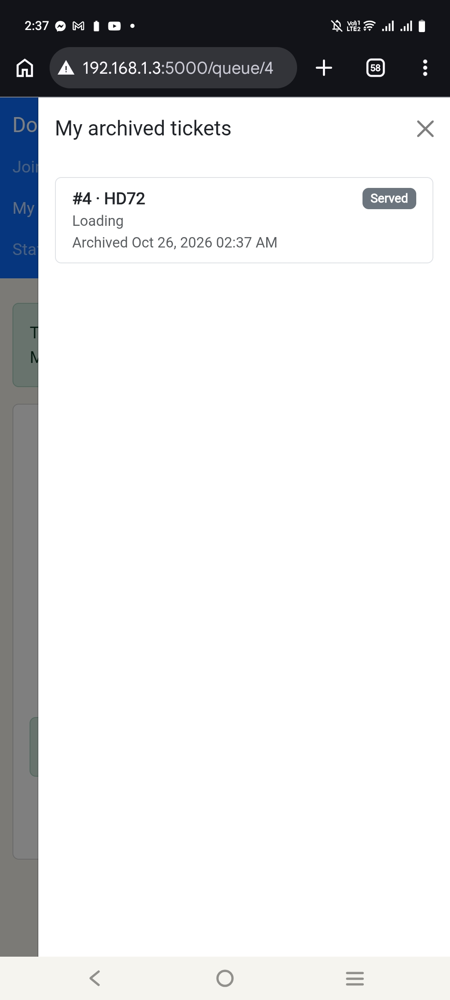 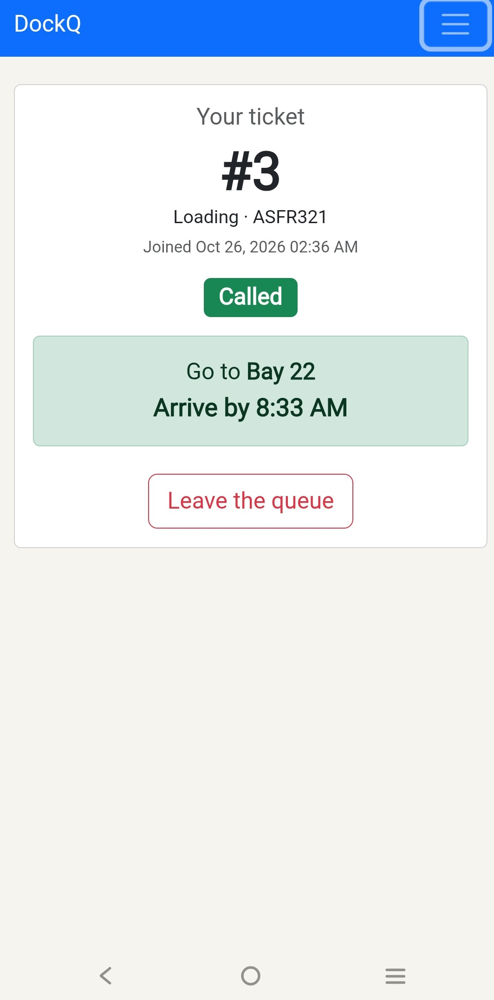    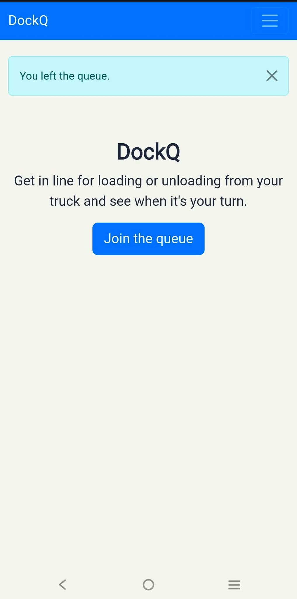 | 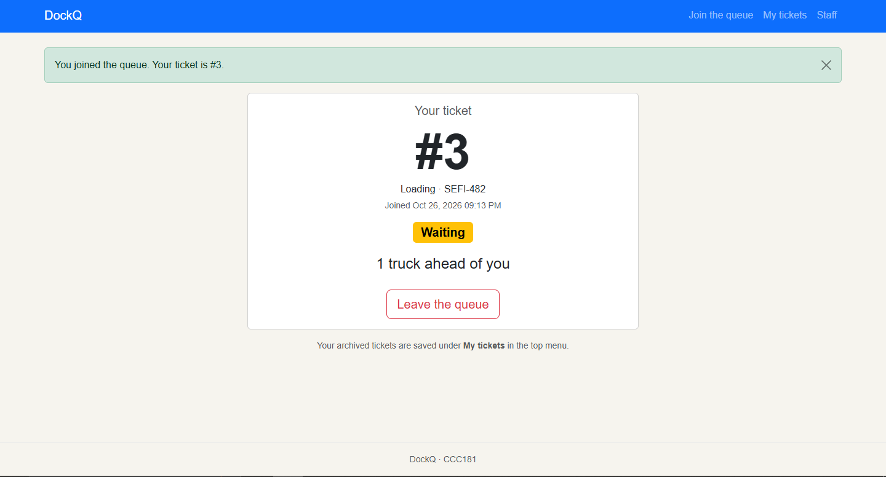 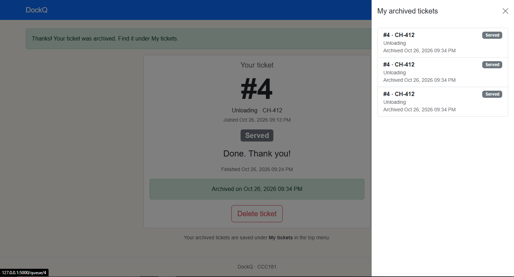 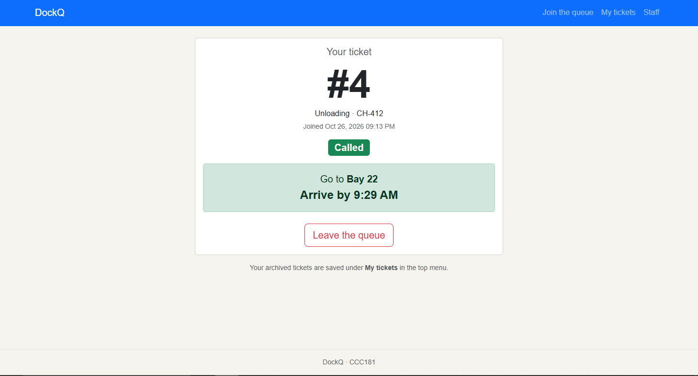   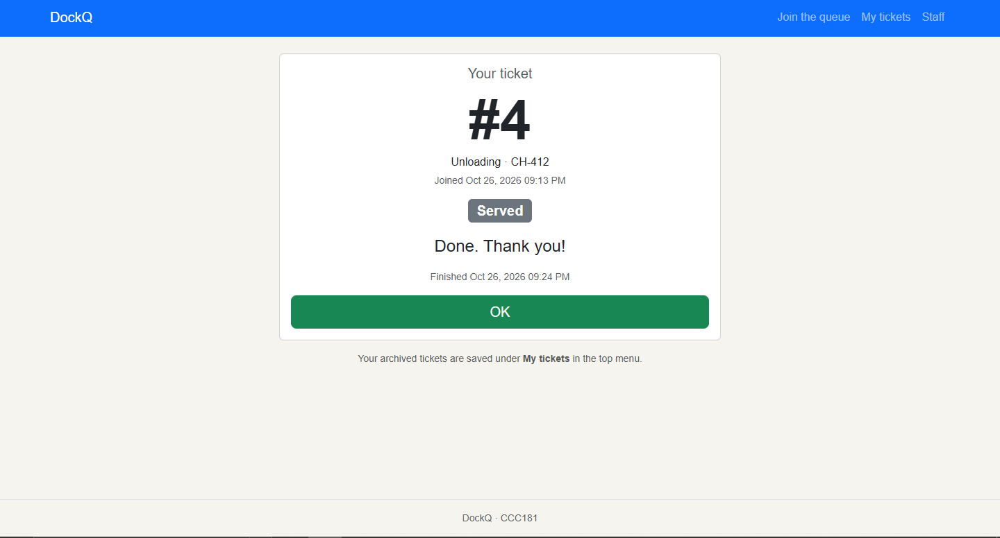 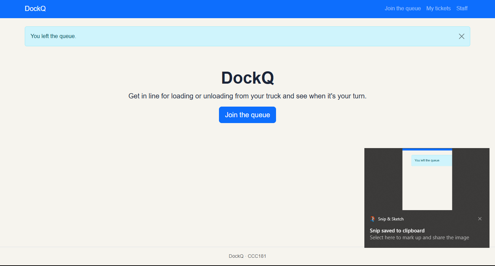  |

### Screen 3: Staff dashboard

Liza uses this screen to filter the queue by service, call the next ticket and mark tickets as served or no-show, covering **FR-05** (Staff can see the waiting list, filtered by service), **FR-06** (Staff can call the next truck and assign a bay), **FR-07** (Staff can mark a truck served or no-show), **FR-08** (Staff can see how many trucks are waiting per service).

| Phone | Laptop |
| --- | --- |
| 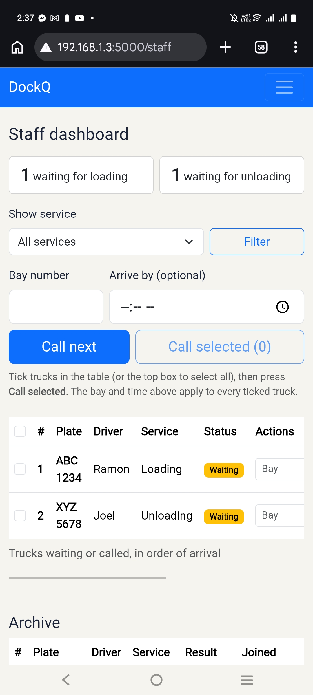  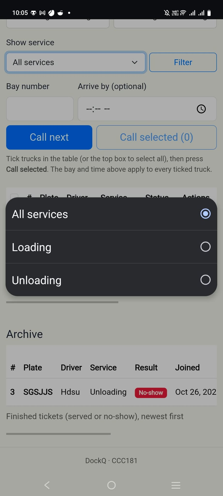 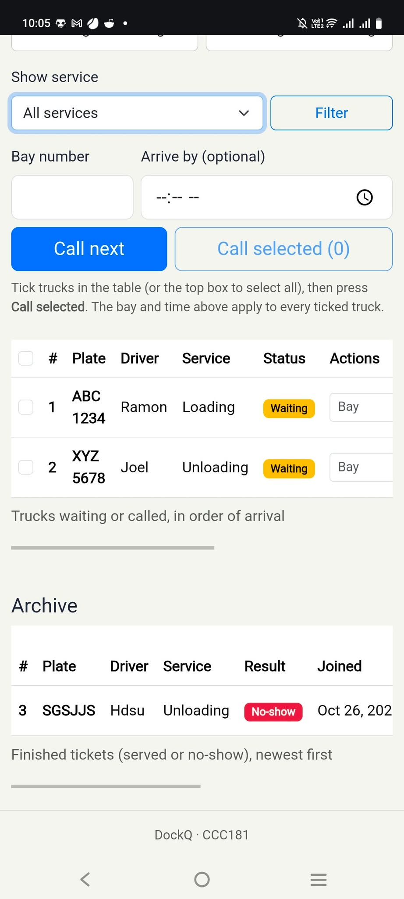 | 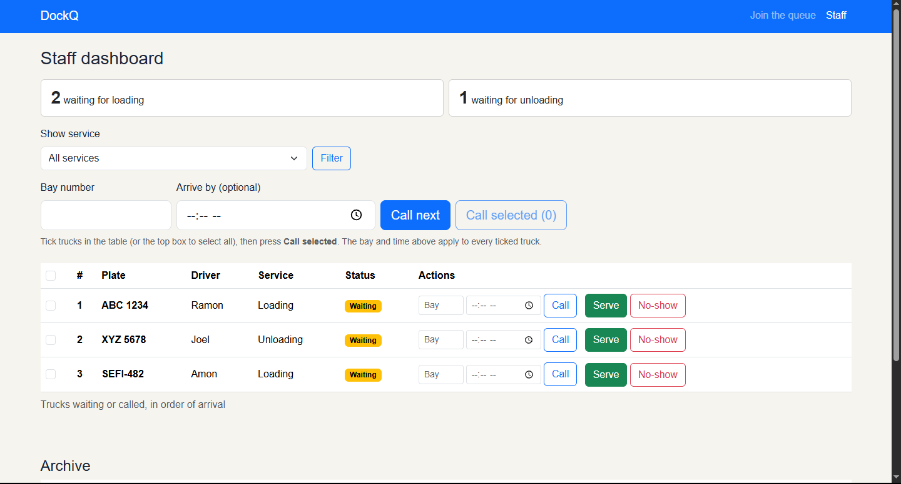 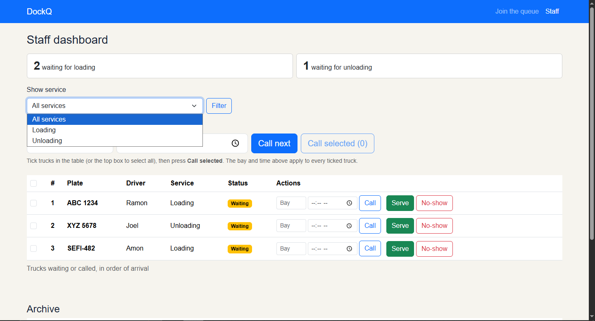  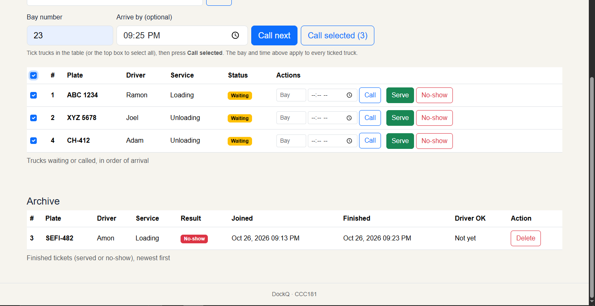 |

## Design decisions

1. **The ticket number is the largest thing on the My ticket page.** As it would be the most important thing to see to pass security if needed then highligthed the time in which he is to go and the status whether they are waiting or in call or was served is color coded and put into emphasis as those are all important key points

2. **The ticket status updates by itself every 10 seconds.** The page checks `/queue/<id>/status.json` in the background and updates the badge and sentence inside an `aria-live` region, so screen readers announce the change too. The "Refresh status" button is still there as a backup. This follows Ramons need of needing updates whether if its his turn or not ("Waiting", "1 truck ahead of you").

3. **"Archive" shows tickets and past ones.** The stakeholders requires records as such tickets being archived whether they opt to leave or get thier business done is a must.

## Self-review

Full notes: [docs/week3/feedback.md](feedback.md)

| Screen | Main problem in my first wireframes | What I changed |
| --- | --- | --- |
| Services / Join | N/A  | N/A  |
| My ticket | Underestimated the tech literacy of the user so they did not know here to access archive on phone  | Informed the user where |
| Staff dashboard | N/A   | N/A  |

Note: I had an informal interveiw with my Mother who is not Liza, I asked questions upon what is expected about Trucking queues as such I did not encounter much problems about tackling the personas problems as I knew already beforehand

## Accessibility

Full notes: [docs/week3/accessibility.md](accessibility.md)

| Screen | Lighthouse accessibility before | After |
| --- | --- | --- |
| Join | 100 | 100 |
| My ticket | 100 | 100 |
| Staff | 95| 95|

## Usability test

Full notes: [docs/week3/usability-test.md](usability.md)

| Task | Finished? | Time | What happened |
| --- | --- | --- | --- |
| 1. "Request Ticket." | Yes | about 25s | They were able to easily fill-up the form and choose their desired service |
| 2. "How many people are ahead of you? What is your number?" | Yes | Almost Immediately | They were able to easily identify the queue details |
| 3. "Pretend you are the staff member. Call the next person and mark them as served." | Yes | about 10s | They were able to easily manage the customer tickets |

### Improvement/s I made

**Problem seen in the test:** none

**Change:** none

| Before | After |
| --- | --- |
| none | none |

## Reflection

**What was hardest this week**

The hardest part was getting my development setup and the files to work together. My computer
had no working `py` or `python` command, because Windows only had the Microsoft Store placeholder,
so I had to run the app through `uv` instead. My project files were also inside a `my-app` folder,
so Flask kept saying it could not import `app` until I ran it from the right folder.

The second hardest part was keeping `app.py` and the templates in step. Each time I added a feature
(the archive, the My tickets panel, the arrive-by time, selecting several trucks), a template or a
route was out of date and the page showed an error or an empty box. I learned to change the route,
the template and the JavaScript together and to test with a fresh ticket straight away.

Because my data lives in a Python list, every time I saved a file the server restarted and my test
tickets disappeared. That made testing slow and confusing, and a ticket page I had open turned into
a 404.

Designing for real users was also harder than I expected. In my usability test the driver finished
every task, but he did not notice that his archived tickets were behind the phone menu button.
That showed me that something can be obvious to me and invisible to a first-time user.

**What I will change when the data moves to a database in Week 4**

- **Tickets table instead of a list.** Each ticket becomes a database row, so tickets survive a
  server restart and I no longer lose test data.
- **Real columns for the new fields.** Status, bay, arrive-by time, joined time, finished time and
  the driver's OK time become columns. Ticket numbers will come from the database instead of a
  counter in my code, and the archive will be a query on the status instead of a separate list.
- **A proper owner for "My tickets".** Right now the panel remembers a driver through a browser
  cookie, so it empties if the cookie is cleared or the driver uses another phone. I will link
  tickets to the driver's details (such as plate number or an account) in the database.
- **Cleaner staff actions.** Calling several selected trucks will become one database update, and
  deleting from the archive will remove a row safely.
- **Wireframes first.** I drew my wireframes after building, so next time I will draw and review
  them before writing code, as the activity intends.

## Declaration

- **Claude:** I found it hard to understand the instructions and since MOLE was down it was hard to read through the Github as such I decided to put it into claude and had it guide me upon what to do
It also provided some grammar checks. 

It provided some debugging from bugging codes when I encountered problems like this
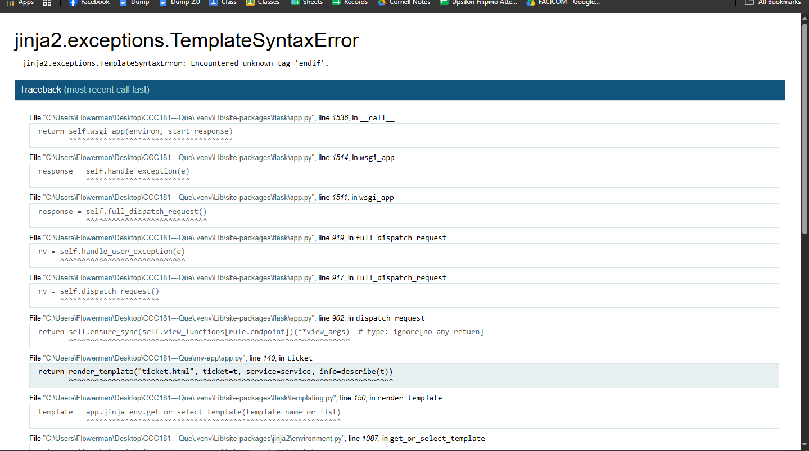

It also helped me fix VScode when I encountered this problem

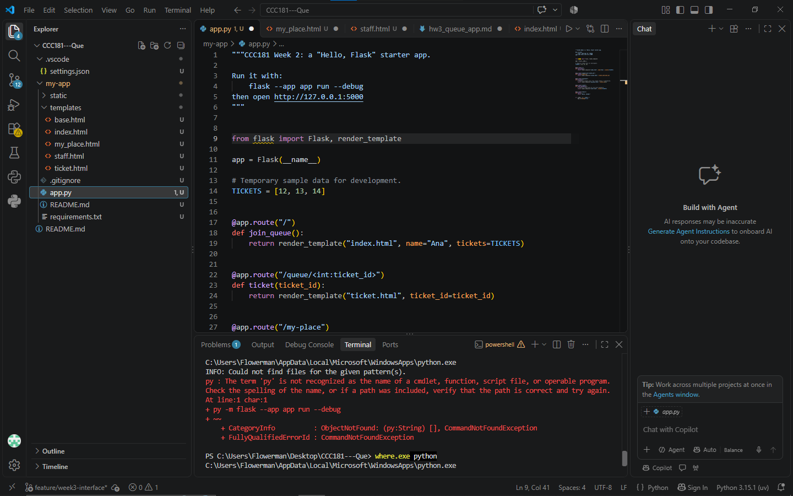

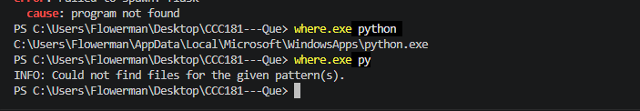

And then I used it to get Inspiration for my wireframe

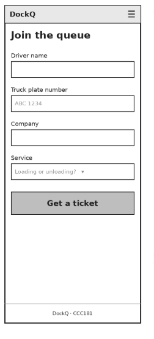
