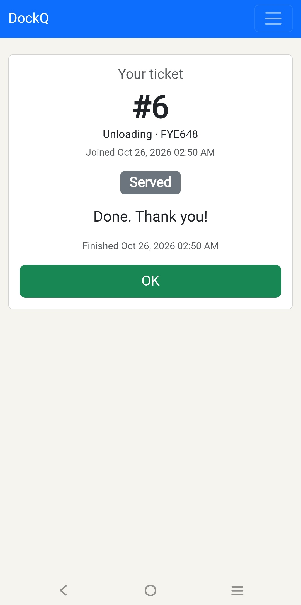
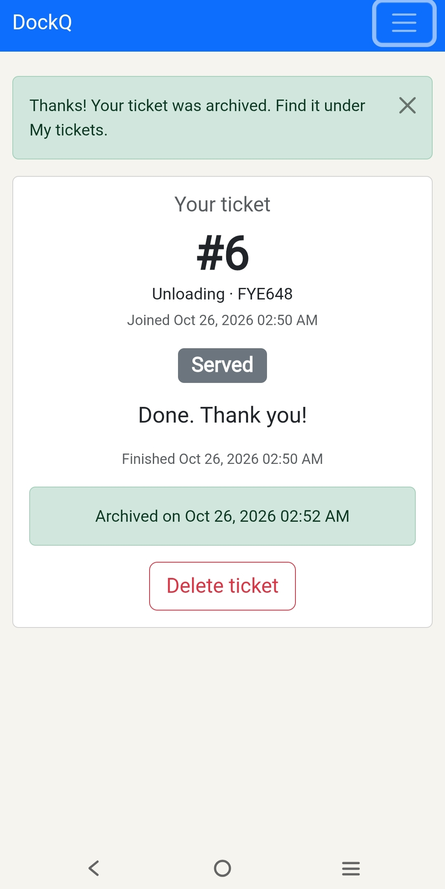

# Usability test

Participant: [Truck Driver]
Device: [Cellphone]   Date: [October 24, 2026]

| Task | Finished? (yes / with help / no) | Time | Where they hesitated / what they said |
| --- | --- | --- | --- |
| 1. Join the loading queue | Yes | 5 seconds | Easy, Simple and Straigforward |
| 2. Find number and trucks ahead | Yes  | 43 seconds | Instantly seen |
| 3. Call next and mark served | Yes  | N/A | This only applies to the staff |

## Most serious problem
The task was simple and most importantly straighforward a bright label and forwad language was able to convey what the Truck Driver could do as such the only problem he faced that was not noticed as he wasnt informed before hand and only because he was on the phone is that he can access the archive using the menu button.

## The fix
Add a note where it says someone can access the archive in the menu button

Before: 
After: 

Participant: [Truck Driver]
Device: [Laptop]   Date: [October 24, 2026]

| Task | Finished? (yes / with help / no) | Time | Where they hesitated / what they said |
| --- | --- | --- | --- |
| 1. Join the loading queue | Yes | 5 seconds | Easy, Simple and Straigforward |
| 2. Find number and trucks ahead | Yes  | 43 seconds | Instantly seen |
| 3. Call next and mark served | Yes  | 30 sec | easily done as its a simple task |

## Most serious problem
N/A

## The fix
N/A

Before: N/A
After: N/A
