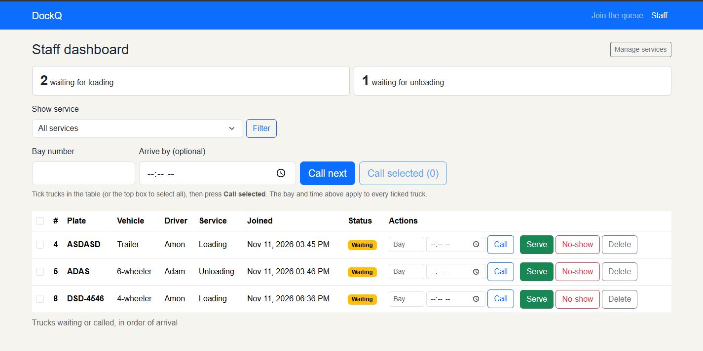
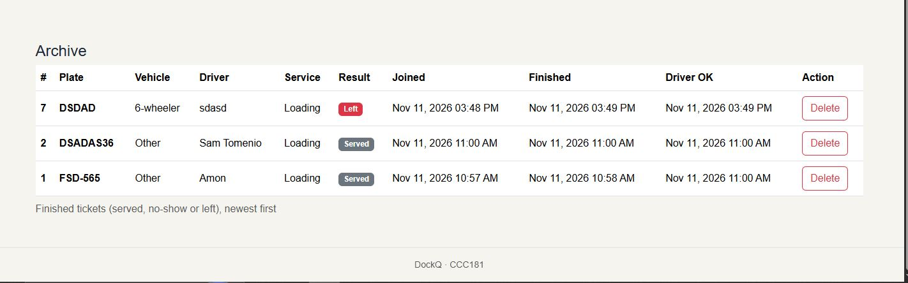
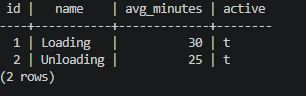
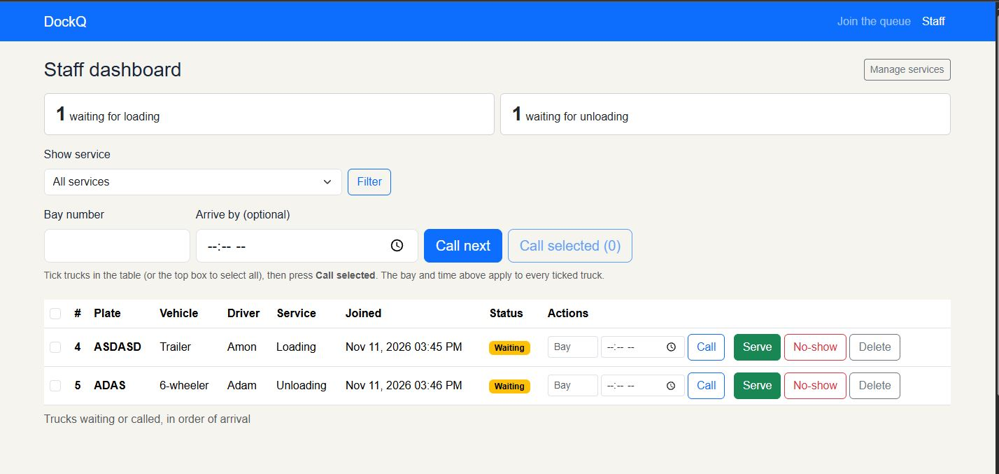
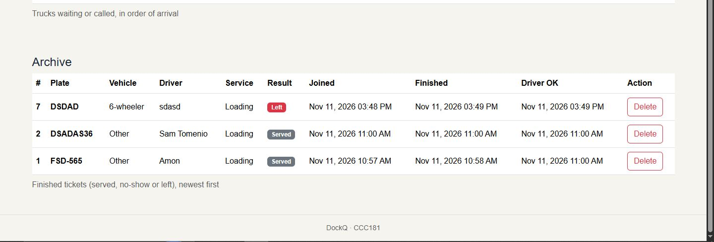
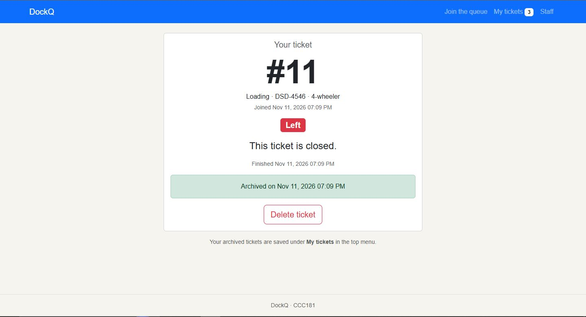
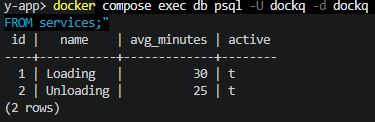

# Persistence proof

This tests **NFR-01** (no ticket is lost when the server or the database restarts).

## 11a. The restart test

1. I created more than five tickets across both services (Loading and Unloading), called one, served one, and let one driver leave.
2. Before the restart, I took screenshots of the staff dashboard and ran this in psql:

   ```sql
   SELECT id, status, service_id, created_at FROM tickets ORDER BY id;
   ```

   
   
   

3. I stopped Flask with Ctrl+C, ran `docker compose down`, and ran `docker compose ps` to see that nothing was running.
4. I ran `docker compose up -d`, waited until `docker compose ps` said **healthy**, and started Flask again.
5. After the restart, I took the same screenshots of the dashboard and ran the same query:

   
   
   
   

**Result:** All N tickets, their statuses and their times were exactly the same after the restart. NFR-01 passed. The data lives in the `pgdata` Docker volume, which `docker compose down` does not delete.

## 11b. Rebuild from scratch

This tests that my migrations can rebuild the whole database on any computer. It deletes all data, so I did it only after 11a.

```
docker compose down -v
docker compose up -d
python -m flask --app app db upgrade
python -m flask --app app seed
```

**Result:** "All three migrations ran in order, `\dt` listed companies, trucks, services and tickets, the seed added Loading and Unloading, and I could open the app, see both services on the join form and join the queue.
