# DockQ: Week 4 Report

## Title details

- **App:** DockQ
- **Setting:** Truck loading and unloading bay, Iligan City
- **Name:** Tomenio, Sam B.
- **Student ID:** 20241845
- **Section:** CS3A
- **Date:** 11/11/2026
- **Database:** PostgreSQL 17 in Docker
- **Pull request:** 

## Requirements

I wrote 14 functional requirements (4 marked ★ for the loading bay setting) and 8 non-functional requirements in [docs/requirements.md](../requirements.md).
 
**MVP:** FR-01 to FR-04, FR-06, FR-07 and FR-11, with NFR-01 to NFR-03. A driver can join, see their place and the bay and time when called, and leave. Staff can call and serve trucks and manage the services, and no ticket is lost or duplicated. It is the smallest version that solves the problem, because it removes the not-knowing and lets drivers wait away from the gate while keeping the queue fair.
 
**Checked with a real person:** I showed the list to a dispatcher and a truck driver. The dispatcher said the app should record what kind of vehicle each truck is (4-wheeler, 8-wheeler and so on). I changed: added a vehicle type to every truck and a dropdown on the join form (FR-14 ★). The driver said all trucks carry goods, so I did not add a cargo type.
## ERD

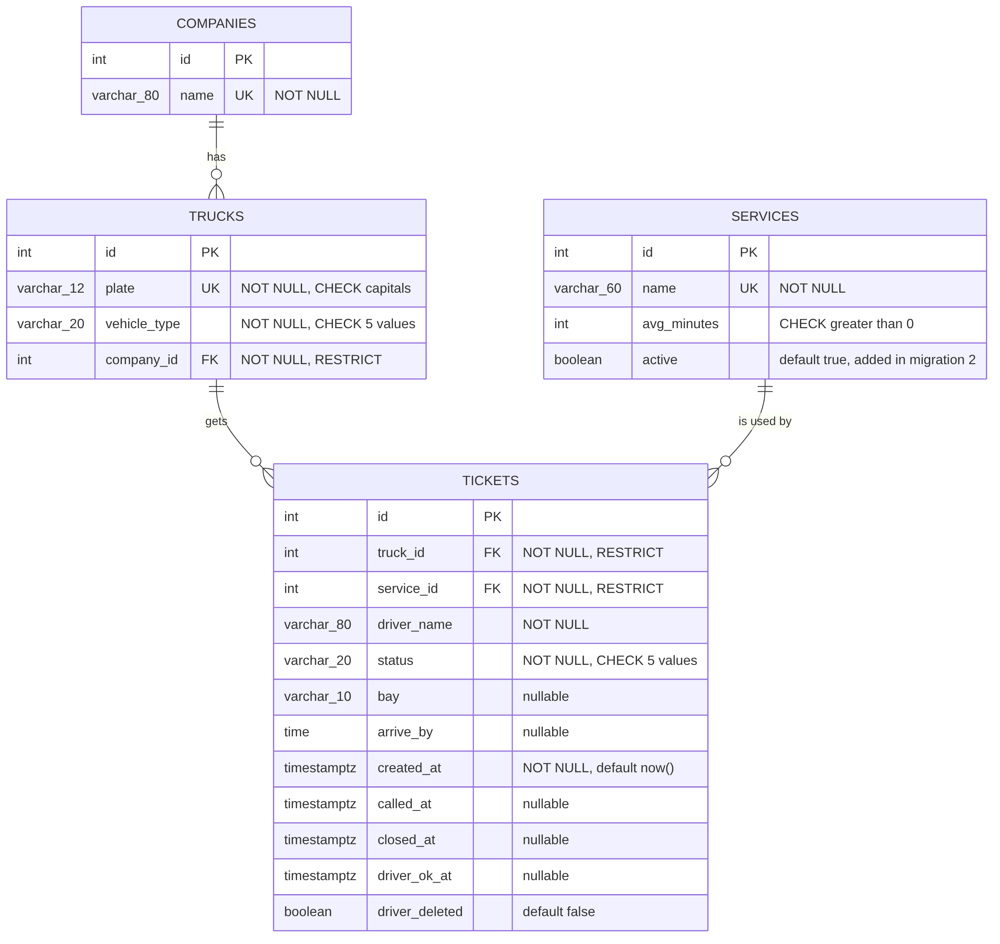

- One company has many trucks. Each truck belongs to one company, or to none when the company is not given.
- One truck has many tickets. Each ticket belongs to exactly one truck.
- One service has many tickets. Each ticket belongs to exactly one service.
- A truck can have only one open ticket (waiting or called) at a time, enforced by a partial unique index.

Full design, with every column, type and constraint: [schema.md](schema.md)

## Schema


```
                                    Table "public.companies"
 Column |          Type          | Collation | Nullable |                Default                
--------+------------------------+-----------+----------+---------------------------------------
 id     | integer                |           | not null | nextval('companies_id_seq'::regclass)
 name   | character varying(120) |           | not null | 


                                      Table "public.trucks"
    Column    |         Type          | Collation | Nullable |              Default               
--------------+-----------------------+-----------+----------+------------------------------------
 id           | integer               |           | not null | nextval('trucks_id_seq'::regclass)
 plate        | character varying(12) |           | not null | 
 vehicle_type | character varying(20) |           | not null | 
 company_id   | integer               |           |          | 

                                      Table "public.services"
   Column    |         Type          | Collation | Nullable |               Default                
-------------+-----------------------+-----------+----------+--------------------------------------
 id          | integer               |           | not null | nextval('services_id_seq'::regclass)
 name        | character varying(60) |           | not null | 
 avg_minutes | integer               |           | not null | 
 active      | boolean               |           | not null | true


                                       Table "public.tickets"
     Column     |           Type           | Collation | Nullable |               Default               
----------------+--------------------------+-----------+----------+-------------------------------------
 id             | integer                  |           | not null | nextval('tickets_id_seq'::regclass)
 driver_name    | character varying(80)    |           | not null | 
 status         | character varying(10)    |           | not null | 
 bay            | character varying(20)    |           |          | 
 arrive_by      | time without time zone   |           |          | 
 created_at     | timestamp with time zone |           | not null | now()
 called_at      | timestamp with time zone |           |          | 
 closed_at      | timestamp with time zone |           |          | 
 driver_ok_at   | timestamp with time zone |           |          | 
 driver_deleted | boolean                  |           | not null | 
 truck_id       | integer                  |           | not null | 
 service_id     | integer                  |           | not null | 

```

## Design decisions

1. **A truck can have only one open ticket, and the database enforces it.** NFR-03 says a truck cannot be in the queue twice at the same time. A check in Python alone could pass for two requests that arrive at the same moment, so I added a partial unique index, `uq_one_open_ticket_per_truck`, on `tickets(truck_id)` for tickets that are waiting or called. Now PostgreSQL itself refuses the second open ticket, and the queue stays fair (NFR-02, NFR-03).
2. **Vehicle type lives on `trucks`, not on `tickets`.** FR-14 asks drivers to choose a vehicle type so staff can see it. The type describes the truck, not one visit, so I store it once on the truck and every ticket for that truck shows it. A CHECK constraint limits it to 4-wheeler, 6-wheeler, 8-wheeler, 10-wheeler, trailer and other.
3. **Position in line is computed, not stored.** For the My place page I count the waiting tickets for the same service that joined earlier, so there is no position column to rewrite whenever a truck joins or leaves.

## Self-review


The problems I found in my schema, from [schema-review.md](schema-review.md):
 
- **Problem:** ClinicQ's `users` table did not fit a truck bay, because the person waiting is a driver with a truck. **Change:** I split the data into `companies`, `trucks`, `services` and `tickets`.
- **Problem:** I had to decide which facts belong to the truck and which belong to one visit. **Change:** plate and vehicle type are in `trucks`, while driver name, bay and arrive-by time are in `tickets`, because a different driver can bring the same truck on another day.
- **Problem:** A stored position in line would need rewriting whenever a truck joins or leaves. **Change:** I store only `created_at` and compute how many trucks are ahead.
- **Problem:** Deleting a company, truck or service could erase old tickets that the reports (FR-12) need. **Change:** every foreign key uses ON DELETE RESTRICT, and staff switch a service off with `active` instead of deleting it.

## Migrations

- `0c7a261eb7fa_create_companies_trucks_services_tickets.py`: creates the `companies`, `trucks`, `services` and `tickets` tables with their keys, constraints and defaults. `7e9586fb5792_add_services_active.py`: adds the `active` column to `services`, so staff can switch a service off without deleting it.
- `7e9586fb5792_add_services_active.py`: gives `status`, `vehicle_type` and `driver_deleted` database-level defaults, so rows inserted directly in psql are valid too.

## CRUD

| Operation | Route | Requirement | Screenshot |
|---|---|---|---|
| Create | `POST /join` | FR-01, FR-14 | 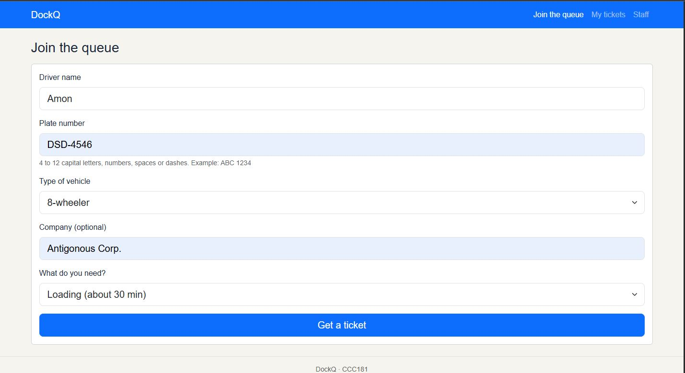 |
| Read | `GET /queue/<id>` and `GET /staff` | FR-02, FR-03, FR-04, FR-05, FR-06, FR-07, FR-08 | 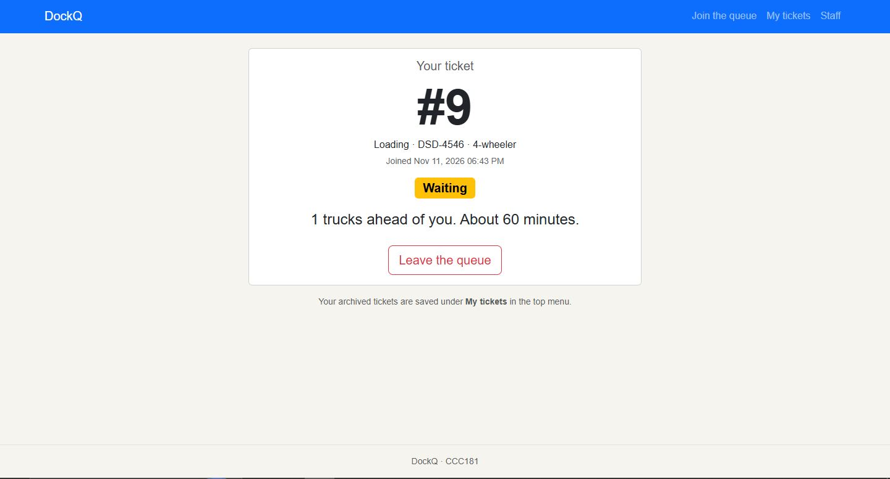 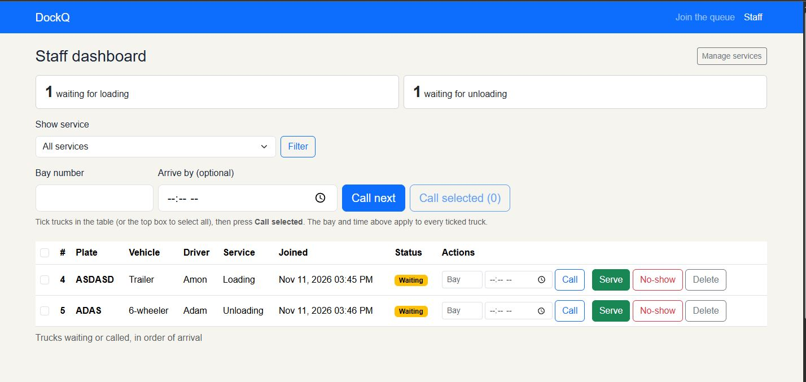 |
| Update | `POST /staff/call-next`, `POST /staff/call-selected` and `POST /staff/<id>/<action>` | FR-06, FR-07, FR-08, FR-10, FR-11, FR-12  | 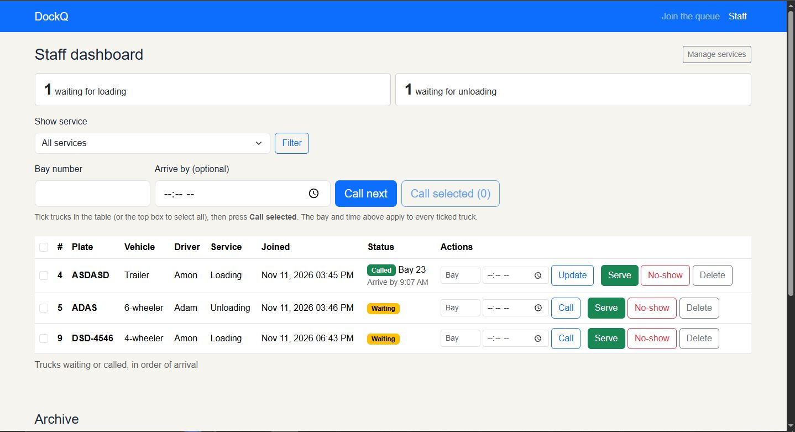  |
| Soft delete | `POST /queue/<id>/leave` | FR-10 | 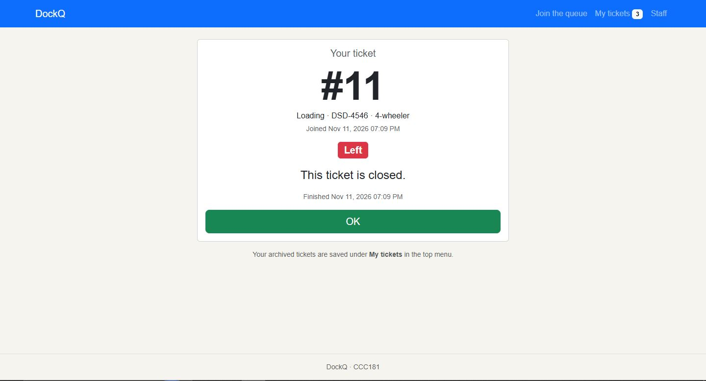 |
| Hard delete | `POST /staff/<id>/delete` | FR-08, FR-10, FR-11, FR-12 | 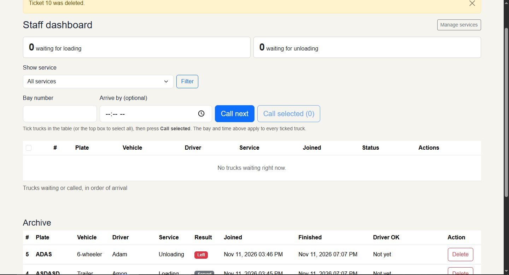 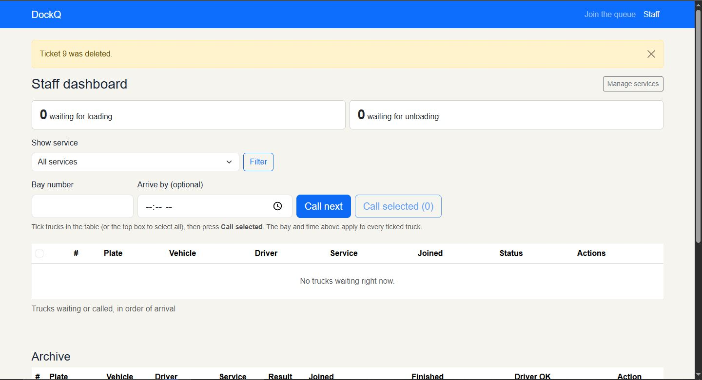 |


## Validation

Full results: [validation.md](validation.md). The browser, Flask and the database all check the data. Requests that skip the form get a 400 and save nothing, and every bad insert in psql fails with a clear error for each constraint type.

The PostgreSQL error I found most useful:

```
ERROR:  new row for relation "trucks" violates check constraint "ck_trucks_plate"
```

## Persistence

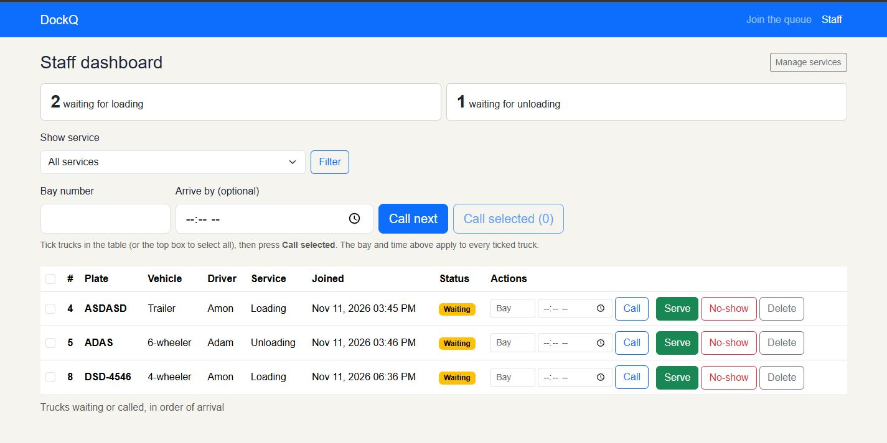
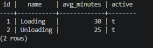


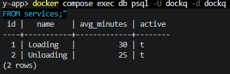

No ticket was lost on restart, so FR-10 Is satisfied. This tests that my migrations can rebuild the whole database on any computer. It deletes all data, so I did it only after 11a.

## Reflection

## Reflection

The hardest part this week was adapting the existing queue system to DockQ's truck-loading setting, particularly designing the database relationships, constraints, and migrations to ensure accurate and reliable queue management. I also learned the importance of enforcing rules at the database level rather than relying solely on Python validation. Feedback from the dispatcher and driver helped refine the requirements, especially the addition of vehicle types. Through implementing and testing CRUD operations, validation, and persistence, I gained a better understanding of how a properly designed database keeps the system consistent and prevents data loss.


## Declaration

I used Claude to help draft my requirements, schema, ERD, models, Docker Compose file, routes, templates and first versions of my documents, adapted from the activity and my Week 3 app. I ran the commands, tested the app, took the screenshots and checked the results myself.
